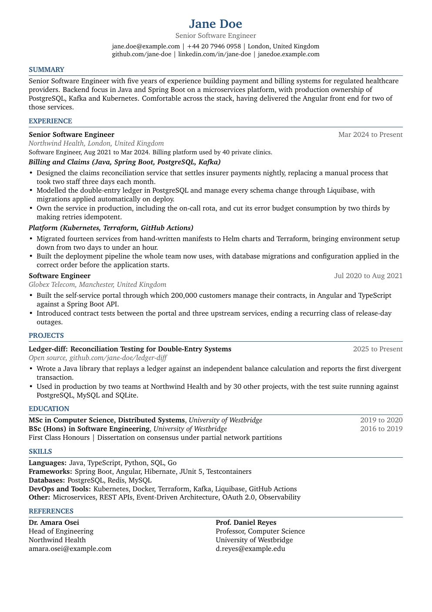

# latex-cv-kit

[](https://github.com/imshaaz21/latex-cv-kit/actions/workflows/ci.yml)
[](LICENSE)

A LaTeX CV and cover letter kept under version control, with one git branch per job
application.

<p align="center">
  
  
</p>

Applying for jobs tends to produce a folder of files called `CV_final_v2_acme.pdf` and no
reliable record of which one went where. This repository treats a CV the way you would
treat code. The content is a single plain-text file, the wording is separate from the
layout, each tailored version is a branch, and each application you actually send becomes
a tag you can diff against your CV as it stands today.

It is a template to copy rather than a dependency to install. What it adds to git and
`latexmk` is two shell scripts and a set of conventions that stop the branches getting out
of hand.

```
main                          your facts: honest, complete, one page
├── profile/backend           long lived: how you present for backend roles
│   └── job-acme-backend      short lived: tailored, sent, then tagged sent/acme-backend
└── profile/platform          long lived: how you present for platform and SRE roles
    └── job-globex-sre        short lived
```

## Requirements

- git and bash.
- A TeX distribution providing `pdflatex` and `latexmk`. TeX Live and MacTeX both work.
  [mise](https://mise.jdx.dev) is optional and recommended: `mise.toml` pins TinyTeX and
  `run.sh` shells out through `mise exec`, so the PDF renders identically everywhere.
- Optional: `pdfinfo` from poppler for the page-count check, and `rclone` for `--upload`.
  The build works without either.

The engine must be pdfTeX. The two ATS lines in the preamble are pdfTeX primitives, so
xelatex, lualatex and Tectonic will fail on them.

### Platforms

| Platform | Notes |
| :--- | :--- |
| Linux | Native. |
| macOS | Native. The scripts avoid GNU-only `sed` so they work with BSD userland. |
| Windows | Use Git Bash, which ships with Git for Windows, or WSL. `.gitattributes` forces LF endings so the scripts stay executable. |

CI runs the workflow test suite on all three on every push.

## Getting started

```bash
git clone https://github.com/imshaaz21/latex-cv-kit.git my-cv
cd my-cv
cp config.example.tex config.tex
mise install
./run.sh
```

`config.tex` is the only file you edit. It holds your name, contact details, summary,
experience bullets, projects, education, skills, referees and the cover letter body.
`main.tex` and `cover_letter.tex` are layout, and you can ignore them until you want to
change how the page looks.

The build writes `Your_Name_CV.pdf` and `Your_Name_Cover_Letter.pdf`, named from
`\cvName`, and opens both. It warns about two things that are otherwise easy to miss: a CV
that has spilled onto a second page, and an overfull box, which means text running past
the margin with no visible error.

The shipped `config.example.tex` is fictional but complete. It is written to show the
bullet style that works, so read it once before replacing it.

### Without a local TeX install

Overleaf compiles this unmodified:

1. Download the repository as a zip and upload it with **New Project**, **Upload Project**.
2. Rename `config.example.tex` to `config.tex`.
3. In **Menu**, set **Compiler** to **pdfLaTeX** and **Main document** to `main.tex`.

You lose the branch workflow, since that is local git, but the documents build.

## Branch strategy

The reason most attempts at this collapse is that every application becomes a branch,
nothing is deleted, and after thirty applications nobody can tell which branches are
current. The convention here is three tiers, with changes flowing upward only.

**`main` is your facts.** Everything true about you, honest and complete, kept to one
page. It is the only branch you actively maintain. A new role, a corrected date, a layout
fix: it goes here, and every future application inherits it.

**`profile/*` branches are how you present, not what you did.** Most people apply for two
or three kinds of role rather than thirty different ones. A profile holds only the
differences for one category: a summary that leads with the relevant stack, the skills
lines reordered, a different selection of bullets. Keep two to four of them, never one per
company.

```bash
git checkout -b profile/backend   # from main, edit config.tex, commit
```

**`job-*` branches are disposable.** Start one from the closest profile, tailor it for the
specific post, build, send, then retire it.

```bash
./track.sh start acme-backend profile/backend
# edit config.tex: the cover letter fields, and whatever wording the post calls for
./run.sh                                      # Jane_Doe_CV_Acme_Backend.pdf
git commit -am "Acme backend application"
./track.sh sent                               # tags sent/acme-backend, deletes the branch
```

### Why a sent application becomes a tag

Once an application is out the door it is a record, and a record that can still be edited
is not evidence of anything. `./track.sh sent` freezes the commit as an annotated tag
carrying the date, then deletes the branch. Your branch list stays at three or four while
the history stays complete, and you keep a permanent answer to the question of what a
particular employer actually read.

Two rules follow. Never merge `main` into a sent application, because backporting a later
fix into something already submitted falsifies it. And cherry-pick anything that was not
job specific onto `main` before retiring the branch, or it dies with the branch.

### Keeping it aligned

```bash
./track.sh sync                  # rebase every profile/* onto main
./track.sh log                   # applications sent, newest first
./track.sh diff acme-backend     # what you claimed there against your CV today
./track.sh open acme-backend     # restore that tailoring to reuse it elsewhere
```

Run `sync` after any change to `main`. Only the handful of profile branches are kept
current, which is what makes this survive contact with a real job search. Sent tags are
never touched. Conflicts are reported per profile and the rebase is aborted rather than
left half-applied, and a dirty working tree is refused.

`diff` is the one worth remembering. Run it the morning of an interview and you can see
exactly what the people across the table are holding. Comparing two applications is plain
git:

```bash
git diff sent/acme-backend sent/globex-sre -- config.tex
```

### Tracking your own content

The template ships with `config.tex` gitignored, so cloning it and filling it in cannot
publish your details by accident. The branch workflow needs that file tracked, and
tracking it puts your name, contact details and employment history into the repository's
history permanently. That is only safe in a **private** repository:

```bash
./track.sh private               # un-ignores and stages config.tex, after confirming
git commit -m "Track my CV content"
```

Keep that repository private. Making it public afterwards publishes every past version,
and on GitHub a rewritten history remains reachable through the fork network. If you later
want to share your layout, publish a separate repository rather than changing the
visibility of this one.

## Working with an AI coding agent

Tailoring a CV is a task coding agents are genuinely good at, and also one where they fail
badly by default: asked to match a job post, a model will cheerfully add a framework you
have never used. [`AGENTS.md`](AGENTS.md) exists to prevent that. It sets out the rule
that content only ever goes in `config.tex`, the evidence rule that no claim may be
written unless it traces to the repository or to something you have confirmed, explicit
lists of what counts as tailoring as against invention, the build checks that must pass
before work is reported as done, and the cases where the agent should stop and ask.

`AGENTS.md` is the convention most coding agents now read. If yours expects a different
filename, link it rather than keeping two copies:

```bash
ln -s AGENTS.md CLAUDE.md
```

A prompt that works well, with the job post saved alongside the repository:

```
Tailor my CV for the role in jd.txt. Read AGENTS.md first.
Start a branch with ./track.sh start acme-backend, edit config.tex only, and
list every claim you could not source from this repo so I can confirm or drop it.
```

The last clause matters most. The useful output of an agent here is not the rewritten
bullets, it is the list of things it wanted to claim on your behalf and could not justify.

## ATS

Applicant tracking systems parse PDFs, and most of what breaks them is layout rather than
wording. The known failure modes and what this template does about each:

| Failure mode | What this template does |
| :--- | :--- |
| Multi-column layouts read across the page, interleaving the columns | Single column throughout. The side-by-side referees use `minipage`, which is read in order |
| Tables are skipped or flattened | No tables. Skills are plain text lines |
| Contact details in a page header or footer are treated as boilerplate and dropped | `\pagestyle{empty}`, with the contact line in the body of the first page |
| Icon fonts extract as `□`, `?` or an internal glyph name | No icons. Text labels and `|` separators only |
| Ligatures and custom encodings produce mangled extracted text | `\input{glyphtounicode}` and `\pdfgentounicode=1` map glyphs back to Unicode |
| Hyphenated line breaks parse as two words | `\hyphenpenalty=10000` and companions disable hyphenation. Body text is ragged right so the spacing still looks right |
| Invented section names stop the parser finding Experience or Education | Standard headings only: Summary, Experience, Projects, Education, Skills, References |

No template can promise to pass a specific system, and anyone claiming otherwise is
guessing. Read your own output the way a parser does:

```bash
pdftotext main.pdf -
```

If the headings are in order and no word is split, the layout is doing its job. CI runs
that same check on every push.

## Adding a section

Sections are three lines. Define the content in `config.tex`:

```latex
\newcommand{\cvCertifications}{%
  \textbf{CKA: Certified Kubernetes Administrator}, The Linux Foundation \hfill {\color{muted}2025}\\
  \textbf{AWS Solutions Architect, Associate}, Amazon Web Services \hfill {\color{muted}2024}
}
```

and place it in `main.tex` where you want it to appear:

```latex
\section{Certifications}
\cvCertifications
```

Publications, talks, languages and volunteering all follow the same pattern. Keep the
heading conventional if an ATS will read the document.

## Repository layout

```
├── config.example.tex    sample content, fictional and complete
├── config.tex            your content (gitignored by default)
├── main.tex              CV layout
├── cover_letter.tex      cover letter layout, sharing config.tex
├── run.sh                build, name the PDFs, check pages and margins
├── track.sh              start, send, log, sync, diff and reopen applications
├── mise.toml             pinned TeX toolchain
├── AGENTS.md             instructions for coding agents
├── docs/                 preview images used by this README
├── tests/workflow.sh     end-to-end test of the branch workflow
└── .github/workflows/    CI: tests on three platforms, lint, build
```

There is deliberately no Makefile or task runner. The two scripts already are the
interface, and a third file wrapping them would be indirection rather than convenience.
`./track.sh` with no arguments prints what it can do.

On a job branch the build also copies its outputs to `applications/<Company_Role>/`, which
is gitignored, so switching branches never overwrites an earlier application's files.
`./run.sh --upload` additionally mirrors them to your own rclone remote, defaulting to one
named `gdrive` and overridable with `CV_RCLONE_REMOTE`. Plain `./run.sh` is entirely
offline.

## Tests

```bash
./tests/workflow.sh
```

It clones the committed state into a temporary directory and exercises the whole
workflow: that a fresh clone will not leak personal data, that `private` opts in cleanly,
that an application can be started, sent, logged, diffed and reopened, that `sync` brings
profiles forward without rewriting a sent tag, and that a dirty tree is refused without
leaving a rebase half-applied. It needs only git and bash, which is why it can run on
Linux, macOS and Windows alike.

## What this is not

- Not a resume builder. There is no interface, no hosted service and no account. If you
  would rather fill in a form than edit a text file, this is the wrong tool.
- Not a guarantee about any applicant tracking system. See above.
- Not a layout you can restyle without reading some LaTeX. The content split means you can
  avoid that for ordinary use, but changing the design means editing `main.tex`.
- Not safe to use as a public repository once you track your own `config.tex`.
- Opinionated about length. `main` is checked for one page, because one page is the right
  default for most engineers. Remove the check in `run.sh` if you disagree.

## Contributing

Issues and pull requests are welcome, particularly for portability problems on other TeX
distributions and platforms. Two constraints: no change may make it easier to publish
personal data by accident, and the scripts stay POSIX-compatible in their use of `sed` and
friends so they keep working with BSD userland. Run `./tests/workflow.sh` before opening a
pull request.

## Licence

[MIT](LICENSE). The sample content in `config.example.tex` is fictional and exists to be
replaced. What you write in your own `config.tex` is yours.
