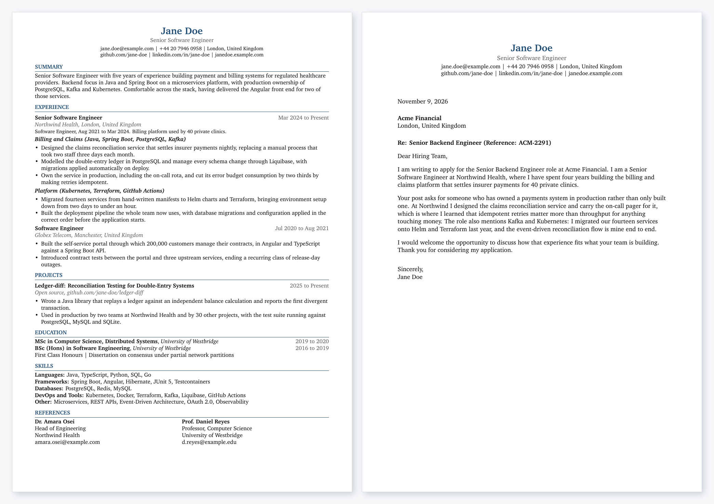

# latex-cv-kit

Your CV in git. One branch per application, one tag per thing you actually sent.

[](https://github.com/imshaaz21/latex-cv-kit/actions/workflows/ci.yml)
[](LICENSE)
[](main.tex)



## The problem

```text
~/Downloads/
  CV_final.pdf
  CV_final_v2.pdf
  CV_acme_USE_THIS.pdf
  CV_final_v2 (1).pdf          which one did Globex get?
```

```text
main                              your facts, honest, one page
└── profile/backend               how you present for backend roles
    └── job-acme-backend          tailored for one post
        └── sent/acme-backend     frozen the day you sent it
```

`./track.sh diff acme-backend` shows what a company is holding, against your CV today.
Run it the morning of the interview.

## Quick start

```bash
git clone https://github.com/imshaaz21/latex-cv-kit.git my-cv
cd my-cv
cp config.example.tex config.tex    # your content, gitignored by default
mise install                        # or any TeX Live or MacTeX install
./run.sh
```

`config.tex` is the only file you edit. `main.tex` and `cover_letter.tex` are layout. The
sample content is fictional but complete, written to show the bullet style that works.

## One application, start to finish

```console
$ ./track.sh start acme-backend profile/backend
On job-acme-backend, branched from profile/backend.

$ ./run.sh
Built Jane_Doe_CV_Acme_Backend.pdf (1 page)
Built Jane_Doe_Cover_Letter_Acme_Backend.pdf (1 page)

$ git commit -am "Acme backend application"

$ ./track.sh sent
Tagged sent/acme-backend and deleted job-acme-backend.

$ ./track.sh log
SENT        APPLICATION
2026-11-09  acme-backend
```

The build warns about the two failures you cannot see in a PDF: a CV that has spilled onto
a second page, and text running past the margin.

## How the branches work

| Tier | Lifetime | Holds | How many |
| :--- | :--- | :--- | :--- |
| `main` | permanent | your facts, honest and complete | one |
| `profile/*` | long lived | how you present for a category of role | two to four |
| `job-*` | days | one specific application | one at a time |
| `sent/*` | frozen | what you actually sent, with the date | one per application |

Changes flow upward only. A sent application is a record, and a record that can still be
edited is not evidence of anything, so `track.sh sent` freezes it as a tag and deletes the
branch. Never merge `main` into one. Cherry-pick anything that was not job specific back
onto `main` before the branch goes.

| Command | What it does |
| :--- | :--- |
| `./track.sh start <name> [base]` | Branch `job-<name>`, refusing a name you already used |
| `./track.sh sent` | Tag the current job branch and delete it |
| `./track.sh log` | Applications sent, newest first |
| `./track.sh sync` | Rebase every `profile/*` onto `main` |
| `./track.sh diff <name>` | What you claimed there, against your CV today |
| `./track.sh open <name>` | Reopen a sent application to reuse the tailoring |
| `./track.sh private` | Track `config.tex` here, for private repositories only |

## Handing it to an agent

Asked to match a job post, a model will cheerfully add a framework you have never used.
[`AGENTS.md`](AGENTS.md) stops that: no claim may be written unless it traces to this
repository or to something you confirmed.

```text
Tailor my CV for the role in jd.txt. Read AGENTS.md first.
Start a branch with ./track.sh start acme-backend, edit config.tex only, and
list every claim you could not source from this repo so I can confirm or drop it.
```

The last line is the point. The useful output is the list of things it wanted to claim on
your behalf and could not justify.

## Privacy

`config.tex` is gitignored, so filling it in cannot publish your details by accident. The
branch workflow needs it tracked, which is only safe in a **private** repository. Run
`./track.sh private` to opt in, and keep the repository private afterwards.

## ATS

Single column, standard headings, no tables, no icons, hyphenation off, glyphs mapped back
to Unicode so the extracted text is clean. CI checks it on every push. The reasoning, and
what each choice defends against, is in the [guide](docs/guide.md#ats).

## More

- [Guide](docs/guide.md): requirements, platforms, Overleaf, adding a section, tests
- [AGENTS.md](AGENTS.md): the rules an agent follows in this repository
- [Contributing](CONTRIBUTING.md)

## Licence

[MIT](LICENSE). The sample content is fictional and exists to be replaced. What you write
in your own `config.tex` is yours.
